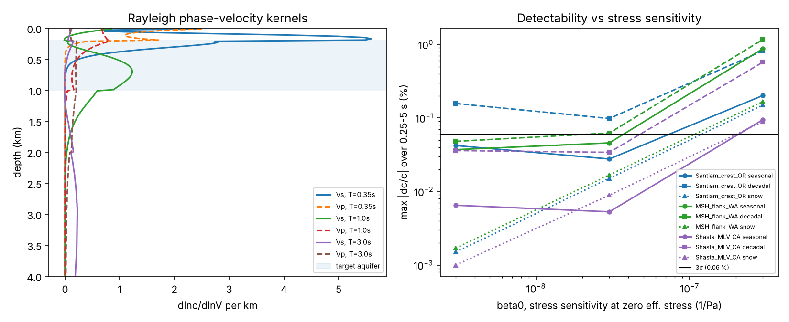

# Addendum 1 — feasibility study (desk study + synthetic forward model)

Status: desk study + synthetic feasibility, Nov 2026. Data-pull scripts are written but **not yet run** (sandbox had no FDSN/USGS access). Every number below is a prior or a synthetic result unless cited.

> Superseded framing: see `00_critique_and_reframe.md`. β₀ and Δh priors updated in Addendum 2.

## 0. Bottom line

1. **Static ambient-noise Vs tomography alone cannot validate the aquifer.** Saturating fractured lava barely changes Vs (density effect, ~1 %); it mainly raises Vp. In the synthetic, saturating 0.2–1 km depth changes Rayleigh phase velocity by +0.3 to +2.7 % (0.5–3 s), a signal indistinguishable from a ~3 % Vs change. Rayleigh **H/V ellipticity** changes by −2 to −7 % at 0.7–2 s and is the more diagnostic static observable. Use joint dispersion + ellipticity (or receiver functions) to get Vp/Vs.
2. **dv/v sign is not guaranteed.** Pore-pressure rise (softening, −) competes with fracture saturation (Vp stiffening, +). Which wins depends on the near-surface stress sensitivity β₀, which is poorly known. For β₀ ≈ 3×10⁻⁸ Pa⁻¹ the two nearly cancel.
3. **Seasonal dv/v from head is detectable (> 0.06 %) only if β₀ ≳ 10⁻⁷ Pa⁻¹.** Snow load is the same order and opposite sign, lagged by ~3 months. **Decadal** head swings (USGS: wells at the Cascade margin rise and fall by >6 m over wet/dry cycles) give 0.1–1 % and are the better target. That target requires 10–25-year records, which exist only at permanent networks.
4. **The cheapest decisive step is calibration, not acquisition.** The 25-year St. Helens dv/v (Makus, Denolle et al. 2024, SRL) already shows groundwater-dominated seasonality. Fitting it with this forward model pins β₀. β₀ then decides whether the Oregon and California targets are worth instrumenting.
5. **Reframe the "confined" assumption.** Karlstrom et al. (2025, PNAS) map deep (>1 km) *vertical* circulation, high vertical K, and muted hydrographs at the crest. That describes an unconfined, deeply drained system with very large storage, not a confined aquifer. This matters for the physics: an unconfined system has a saturation front (the + term in point 2); a confined one has only pore-pressure change.

## 1. Corrections to the first-pass answer

| First pass said | Revised |
|---|---|
| Target "beneath the Three Sisters" | The mapped 81 km³ aquifer is at the High Cascades crest around Santiam Pass / McKenzie headwaters (Karlstrom et al. 2025). The Three Sisters are the southern extension. Both boxes are in `targets.py`. |
| Tomography needs "weeks to months" of data | Dense arrays converge fast. 2 weeks of nodes at MSH gave 2.5–5 s phase-velocity maps (Wang et al. 2017). Duration is not the constraint; spacing and the 1–5 Hz noise field are. |
| Nodal deployment of 4–8 months | Battery-limited and model-dependent. **Verify with the vendor.** Snow cover at the crest (Nov–Jun) also complicates access. |
| "Low Vs, higher Vp" | Correct in sign for Vp, but saturation-driven Vs drop is ~1 %. Low Vs at edifices mostly reflects fracturing and alteration (Wang et al. 2017 found 10–15 % low velocity under the MSH edifice), not water. |
| "Use existing stations at Adams/St. Helens for a first DVV test" | St. Helens has already been done (Makus et al. 2024). Reuse it for calibration. Adams has sparse coverage; see §4. |
| Seasonal signal is the target | At the crest, hydrographs are muted (Karlstrom 2025) and spring discharge fluctuates little (Meinzer 1927, cited in Marcelli et al. 2022). The robust head signal is decadal. |

## 2. Targets and what is already known

| Target | Hydrogeologic anchor | Existing seismic | Verdict |
|---|---|---|---|
| **Santiam Pass / McKenzie (OR)** | Karlstrom et al. 2025: ≥81 km³ active storage from drill-hole temperature profiles; circulation >1 km deep. Big springs (Olallie, Great Springs, Clear Lake → McKenzie). Upper Deschutes: wells near the range swing >20 ft decadally (Gannett et al. 2001; Gannett & Lite 2013). | Sparse (CVO/PNSN Three Sisters network). Inventory: 5 stations with ≥10 yr metadata span in the Santiam box, 9 at Three Sisters (docs/03). | **Best hydrologic ground truth.** The borehole temperature profiles are an independent depth constraint no other site has. |
| **St. Helens–Adams (WA)** | Karlstrom's "north of the Gorge" aquifer. Adams spring chemistry and isotopes: Nathenson & Mariner 2013 (data release Gregoire et al. 2024). Klickitat springs: USGS OFR 75-518. | **Best seismic.** PNSN since late 1990s. iMUSH broadband (70 stations, 10 km spacing, 2014–16; Crosbie et al. 2019) and nodes (Wang et al. 2017). 25-yr dv/v (Makus et al. 2024). | **Best for calibrating β₀.** Weakest direct well data at high elevation. |
| **Shasta–Medicine Lake–Lassen (CA)** | USGS NVASA project (Marcelli et al. 2022, Hydrogeol. J.): Hat Creek / Fall River springs supply ~half of Pit River flow. Fall River Springs ~34 m³/s fed by Medicine Lake Volcano. Big Springs McCloud ~600 cfs (USGS WRI 87-4239). Transit times 0.8 to >75 yr (LLNL / CalTrout tracer work). | NCSN / CVO around Shasta, Lassen, Medicine Lake. Inventory: ≥10 yr metadata span at 13 (Shasta), 8 (Medicine Lake), 13 (Lassen) stations (docs/03). | **Best spring-discharge record** and largest springs. Deepest water table → weakest dv/v signal in the synthetic. |

## 3. Synthetic forward model (`forward/forward_dvv.py`)

**Setup.** 1-D layered young-lava column (Vs 1.4 → 3.65 km/s; 20 m layering to 3 km). Fundamental-mode Rayleigh, computed with `disba`. Finite-difference dc/c agrees with linearized kernels to ~5 %.

**Perturbations:**
1. Pore pressure below the water table: dlnV = −β(z)·ρ_w·g·Δh.
2. Saturation of the band swept by the rising water table: φ = 5 %, Vp +15 %, Vs density-only.
3. Snow load: dlnV = +β(z)(1−B)ρ_w·g·SWE, with B = 0.5.

**Stress sensitivity.** β(z) = β₀·exp(−σ′/σ_c), with σ_c = 10 MPa (crack closure).

**Noise floor.** 0.02 % (optimistic, multi-pair 10-day stacks); 3σ = 0.06 %.

**Site priors.** All are assumptions; replace with well data.

| Site | Water-table depth | Seasonal Δh | Decadal Δh | Peak SWE |
|---|---|---|---|---|
| Santiam crest | 200 m | 2 m | 8 m | 1.0 m |
| MSH flank | 30 m | 3 m | 4 m | 1.0 m |
| Shasta/MLV | 250 m | 1 m | 6 m | 0.6 m |

**Kernels.** Vs sensitivity peaks at ~170 m (0.35 s), ~0.7 km (1 s), ~2.9 km (3 s). Vp carries 22–33 % of total sensitivity at these periods, which is why saturation shows up at all.

**Peak dc/c (%) over 0.25–5 s** (+ means faster when head is high or snow is present):

| Site | β₀ (Pa⁻¹) | Seasonal head | Decadal head | Snow load | Saturation only |
|---|---|---|---|---|---|
| Santiam crest | 3e-9 | +0.042 @0.35 s | +0.157 @0.35 s | +0.002 | +0.044 |
| Santiam crest | 3e-8 | +0.028 @0.35 s | +0.098 @0.35 s | +0.015 | +0.044 |
| Santiam crest | 3e-7 | −0.202 @0.7 s | −0.821 @0.7 s | +0.150 | +0.044 |
| MSH flank | 3e-9 | +0.037 | +0.048 | +0.002 | +0.046 |
| MSH flank | 3e-8 | −0.046 | −0.062 | +0.017 | +0.046 |
| MSH flank | 3e-7 | −0.875 @0.35 s | −1.168 | +0.167 | +0.046 |
| Shasta/MLV | 3e-9 | +0.006 | +0.036 | +0.001 | +0.007 |
| Shasta/MLV | 3e-8 | −0.005 | −0.034 | +0.009 | +0.007 |
| Shasta/MLV | 3e-7 | −0.095 @0.7 s | −0.574 @0.7 s | +0.089 | +0.007 |

**Reading the table:**
- Low β₀ → the saturation term dominates and dv/v *rises* with head. High β₀ → the pore-pressure term dominates and dv/v *falls*. The sign of the observed dv/v-versus-head correlation is itself a constraint on β₀ and porosity.
- The pore-pressure signal at Santiam peaks at 0.7 s (sampling ~0.2–1 km). That is exactly the depth range of Karlstrom's isothermal zone, so the target is resolvable in principle.
- Shasta/MLV is the hardest case: the deep water table puts the signal below the kernel peak.

**Record length (`forward/separability.py`).** Regress dv/v on head, SWE, lagged temperature, and a trend, with AR(1) noise and Newey–West errors:

| Case | Years for ≥96 % detection of the head coefficient |
|---|---|
| Strong (β₀ = 3e-7, −0.1 %/m) | 1 yr |
| Weak (β₀ = 3e-8, −0.01 %/m) | ~5 yr (46 % at 2 yr) |

⚠️ This is optimistic. It assumes the head time series *at the seismic footprint* is known and the functional forms are correct. In reality head is sparse at the crest, so the head term must come from a recharge–diffusion model with unknown diffusivity (Clements & Denolle 2018 style). That adds parameters and roughly doubles the required record length. Treat these as lower bounds.

**Unmodelled terms:** thermoelastic strain, freeze–thaw of the shallow layer (Makus et al. 2024 suggest frozen ground inhibits infiltration on the MSH edifice), seasonal noise-source migration (snow damps 1–5 Hz noise; river and spring flow noise is itself seasonal), nonlinear healing after earthquakes, and coda body-wave content. The model uses surface-wave kernels; coda dv/v at >1 Hz has a larger Vp/body-wave component.

## 4. Pipeline (`pipeline/`)

| Script | Does | Status |
|---|---|---|
| `targets.py` | 8 target boxes (MSH, Adams, Indian Heaven, Santiam, Three Sisters, Shasta, Medicine Lake, Lassen) | done |
| `01_station_inventory.py` | ObsPy FDSN (EarthScope + NCEDC). Per station: channels, sample rate, years of operation. Per target: # stations ≥5 and ≥10 yr, inter-station distances, usable max period | written, **not run** |
| `02_hydro_inventory.py` | USGS Water Data OGC API via `dataretrieval` 1.4 `waterdata`. Wells, springs, streams in each box; daily discharge (00060); groundwater levels (72019); record length and seasonal range per site | written, **not run** (API host blocked here; request construction verified) |
| `../modflow/hillslope_mf6.py`, `couple_dvv.py` | MODFLOW 6 hillslope (Saar & Manga k(z)) → water table → predicted multi-band dv/v | **run** (mf6 6.7.0) |
| `../forward/band_design.py` | Per-band wavelength, kernel depth, attenuation vs distance | **run** |
| `dvv_stretch.py` | Minimal stretching dv/v with Weaver et al. 2011 error estimate | **tested** on synthetic coda (recovers 2×10⁻⁴ to 5×10⁻³; error estimate conservative) |

**Not covered by the scripts** (pull manually):
- OWRD Well Log Query and WA Ecology Well Reports, for lithology and static water level.
- CA DWR periodic groundwater levels.
- SNOTEL SWE (NRCS AWDB).
- Karlstrom et al. drill-hole temperature profiles (PNAS SI).
- USGS NVASA model inputs.

**Production dv/v.** Use SeisMIC (`pip install seismic`, v0.7.2 — Makus's code, already used at MSH) or NoisePy (`noisepy-seis` 0.9.93). Configure these from their docs; I have not written configs from memory.

**Recommended processing parameters:**
- Bands: 0.25–0.5, 0.5–1, 1–2, 2–4 Hz, to separate the 0.7 s pore-pressure peak from the 0.35 s near-surface/snow layer.
- Pairs: single-station cross-component plus pairs < 10 km.
- Stacks: 10-day.
- Windows: coda lapse ≥ 2× direct arrival.
- Run the spatial inversion (SeisMIC) so the edifice and valley floors are separated, following Makus et al. 2024.

## 5. Recommended sequence

1. **Calibrate β₀ at St. Helens (weeks; no new data).** Take the Makus et al. 2024 gridded dv/v. Pair it with NWIS wells and streams in the MSH box (`02_hydro_inventory.py`) and SNOTEL. Fit the forward model for β₀, σ_c, and φ per band.
   - Decision rule: if β₀ < ~5×10⁻⁸ Pa⁻¹, seasonal validation at the deeper Oregon and California water tables is not feasible. Pivot to decadal signals and static Vp/Vs.
2. **Run both inventories** and fill the empty columns of the §2 table. The key output is the number of stations with ≥10 yr of continuous data in the Santiam, Three Sisters, Shasta, and Medicine Lake boxes.
3. **Santiam static test** (if step 1 passes, or regardless for Vp/Vs):
   - A 2–4 week summer node array, ~1 km spacing, 15–20 km aperture across the western/High Cascades transition at Santiam Pass. That transition is Karlstrom's natural experiment: the same climate on old, shallow-flow rock versus young, deep-flow rock.
   - Joint dispersion (0.3–3 s) + H/V inversion for Vp/Vs, validated against the drill-hole temperature profiles.
   - Prediction to test: higher Vp/Vs and a deeper low-H/V-anomaly signature on the young-rock side.
4. **Long-term dv/v at the crest.** Permanent or semi-permanent broadband (3–6 stations, ≥5 yr), co-located with one instrumented well or spring gauge. Only worth funding if step 1 gives β₀ ≳ 10⁻⁷.

## 6. GAIA hook

The weak link in the GAIA dv/v↔head bridge is the same β(z) prior. These aquifers offer an unusual opportunity: storage and depth are independently constrained by borehole thermometry, and discharge is gauged at large springs. That makes them a field-scale check on the petrophysical bridge before applying it to the 90 m PNW soil grid. A further fit: the decadal signal is exactly what MODFLOW-plus-assimilation is built for.

## 7. Open questions for Leif

- Water-table depth and its range at the crest. Do any of the drill holes have repeat temperature logs (a time-lapse thermal constraint)?
- Are there electrical or EM surveys at Santiam (co-authors Finn and Ball are USGS geophysicists)? Resistivity is the cleanest saturation discriminator to pair with Vp/Vs.
- Which springs have continuous gauging versus spot measurements?

## References

- Karlstrom L. et al. (2025) State shifts in the deep Critical Zone drive landscape evolution in volcanic terrains. PNAS 122(3) e2415155122. doi:10.1073/pnas.2415155122
- Makus P., Denolle M.A., Sens-Schönfelder C., Köpfli M., Tilmann F. (2024) Analyzing volcanic, tectonic, and environmental influences on the seismic velocity from 25 years of data at Mount St. Helens. SRL 95(5) 2674–2688.
- Hotovec-Ellis A.J., Gomberg J., Vidale J., Creager K. (2014) JGR 119, 2199–2214. doi:10.1002/2013JB010742
- Wang Y., Lin F.-C., Schmandt B., Farrell J. (2017) Ambient noise tomography across Mount St. Helens using a dense seismic array. JGR 122, 4492–4508.
- Crosbie K.J. et al. (2019) JGR 124(8) 8358–8375. doi:10.1029/2019JB017836
- Gannett M.W. et al. (2001) USGS WRIR 00-4162; Gannett & Lite (2013) USGS SIR 2013-5092.
- Marcelli M.F. et al. (2022) Hydrogeology Journal, doi:10.1007/s10040-022-02545-x (NVASA).
- Nathenson M., Mariner R.H. (2013) USGS SIR 2013-5097; data release Gregoire et al. (2024) doi:10.5066/P96Q13U3.
- USGS WRI 87-4239 (Mount Shasta hydrology).
- Clements T., Denolle M.A. (2018) Tracking groundwater levels using the ambient seismic field. GRL.
- Weaver R.L. et al. (2011) GJI (stretching error estimate). Sens-Schönfelder & Wegler (2006) GRL.
- Guillemot A. et al. (2021) The Cryosphere 15, 5805 (snow effect on dV/V).
