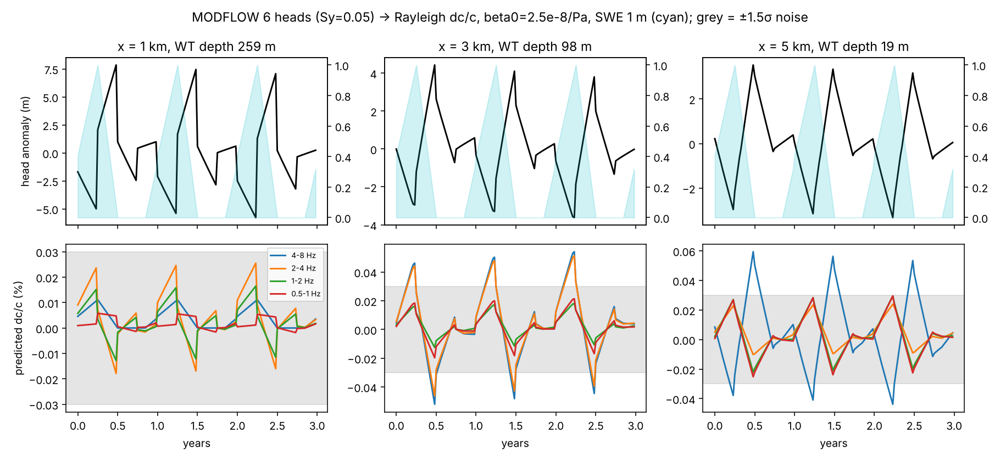

# Addendum 2 — inter-station dv/v, frequency bands, repeaters, hydrology & MODFLOW (St. Helens–Adams)

Nov 14, 2026. New code: `forward/band_design.py`, `modflow/hillslope_mf6.py`, `modflow/couple_dvv.py`. The MODFLOW 6.7.0 runs completed here; the synthetic numbers below come from those runs.

## 0. What changed

1. **β₀ is now calibrated (to within a factor of a few).** Taira & Brenguier (2016) measured a velocity susceptibility of 0.006 MPa⁻¹ at ~1 km under Lassen. With the crack-closure model, that gives β₀ ≈ 2.5×10⁻⁸ Pa⁻¹. Caveats:
   - It is a *dynamic* susceptibility in a pressurized hydrothermal system, so treat it as an upper bound for quasi-static loading in cold aquifers.
   - It places us in the regime where saturation (+) and pore pressure (−) partly cancel. Addendum 1 flagged this as the worst case.
2. **Water-table swings are larger than my priors.** MODFLOW with Saar & Manga's (2004) k(z) and 0.75 m/yr recharge gives 6–21 m seasonal swings upslope (Sy 0.02–0.05), consistent with their 10–20 m estimate. The Δh priors in Addendum 1 (1–3 m) were too low.
3. **Net predicted seasonal dv/v is 0.03–0.1 % peak-to-peak** (MODFLOW → dv/v operator, Sy 0.05, SWE 1 m):
   - Mid-slope (water table ~100 m): detectable at 2–8 Hz.
   - Upslope (water table ~260 m): below noise in every band.
   - **Phase is the discriminator, not amplitude.** dv/v peaks at snow maximum (~1 Apr) and bottoms at the head maximum (~late June), a ~12-week lag. Over a shallow water table (~20 m), the 4–8 Hz band flips sign relative to 0.5–4 Hz.
4. **The band to build around is 1–2 Hz** (Vs-kernel median ~0.5 km, interquartile range 0.37–0.71 km in a young-lava column). Anchor it with 2–4 Hz (~0.17 km) for the near-surface/snow layer and 0.5–1 Hz (~1.1 km) for depth. Attenuation and the 3–6 Hz scattering regime at St. Helens rule out long inter-station paths above ~4 Hz.
5. **Repeating earthquakes are better for time-lapse than for static tomography.** They are co-located, so they add precision rather than ray diversity. Their unique contribution is separate P and S travel-time changes along fixed paths (dVp/Vp vs dVs/Vs). That is exactly the saturation-versus-pore-pressure discriminant ambient-noise Rayleigh waves cannot provide.

## 1. "Goffrey" paper — not identified

I could not find a St. Helens paper by an author matching "Goffrey". Possibly Geoffrey Abers (iMUSH), or one of the attenuation papers below. Please send the DOI.

Attenuation constraints I did find:

| Study | Finding relevant here |
|---|---|
| Gabrielli et al. (GJI, 2020; MLTWA) | Scattering attenuation dominates at 3–6 Hz (albedo ≈ 0.95 at 3 Hz); absorption dominates at 12–18 Hz. Shallow heterogeneity under the 1980 debris avalanche and crater produces anomalous intermediate/late coda: strong **near-receiver** scattering at 3 Hz. |
| De Siena et al. (JGR, 2014) | High-scattering, high-attenuation zones in and below the edifice to ~6 km. A low-velocity, high-attenuation N–S trough (Tertiary marine sediments, St. Helens Seismic Zone) 0–10 km north of the cone. |
| Tusa et al. (BSSA, 2004) | Qp ~30 in the crater area (2–7 and 18–30 Hz); lower Qp for sources shallower than 5.5 km. |
| Taira & Brenguier (EPS, 2016), Lassen | M5.7 dynamic stress → 0.1 % velocity drop at ~1 km depth; susceptibility 0.006 MPa⁻¹. Long-term dv/v tracks snow-induced vertical deformation. |

**Implication:** at 2–4 Hz the St. Helens coda is near-receiver dominated. Use it for single-station/local dv/v, not for long inter-station paths.

## 2. Frequency-band design (`forward/band_design.py`)

Assumptions: young-lava 1-D model, fundamental-mode Rayleigh. Amplitude factor = exp(−πfr/(Qc)) for direct waves at distance r. The "≥2λ" column is the far-field minimum pair distance.

| Band | c (km/s) | λ (km) | Vs-kernel depth, 25/50/75 % (km) | Pair ≥2λ (km) | Amp @5 km, Q30 / Q100 | Amp @10 km, Q30 / Q100 | Role |
|---|---|---|---|---|---|---|---|
| 0.5–1 Hz | 2.23 | 3.2 | 0.79 / 1.13 / 1.59 | 6.3 | 0.85 / 0.95 | 0.72 / 0.91 | Deep reference: snow load and volcanic/tectonic signals |
| **1–2 Hz** | 1.84 | 1.3 | **0.37 / 0.53 / 0.71** | 2.6 | 0.67 / 0.89 | 0.45 / 0.79 | **Primary aquifer band** |
| 2–4 Hz | 1.56 | 0.55 | 0.13 / 0.17 / 0.23 | 1.1 | 0.39 / 0.75 | 0.15 / 0.57 | Shallow / snow / freeze layer; near-receiver coda |
| 4–8 Hz | 1.32 | 0.23 | 0.05 / 0.09 / 0.13 | 0.5 | 0.11 / 0.51 | 0.01 / 0.26 | Only borehole–surface pairs, nodes, or repeaters at < 2–3 km |
| 0.25–0.5 Hz | 2.71 | 7.7 | 90 % above 6 km | 15 | 0.93 / 0.98 | 0.87 / 0.96 | Avoid for hydrology: secondary microseism band, sees the magmatic system |

For comparison, Mao et al. (2022) in Los Angeles sediments used 0.5–2 Hz (~350 m), 0.4–1.6 Hz (~500 m), and 0.2–0.8 Hz (~700 m). The same bands sample about 1.5–2× deeper in lava because velocities are higher.

**Rules:**
- Measure dv/v in all four bands from 0.5–8 Hz.
- Never interpret a single band. The aquifer signature is the *pattern across bands*: sign and phase versus snow.

## 3. Inter-station dv/v strategy

1. **Ballistic Rayleigh dv/v per pair and band.** This is path-averaged and gets depth from frequency.
   - Pros: clean geometry.
   - Cons: biased by seasonal noise-source changes (rivers and wind are seasonal at 1–5 Hz; snow damps them). Mitigate by comparing causal versus acausal lags, rejecting pairs whose asymmetry varies seasonally, and requiring dv/v consistency across azimuths.
2. **Coda dv/v with lapse-time depth control.** Obermann et al. (2016) model coda depth sensitivity as a lapse-time-dependent mix of surface- and body-wave kernels. Early coda is more surface-wave (shallow); late coda adds body-wave (deeper) sensitivity. Combine with the spatial inversion of Makus et al. (2024, SRL; SeisMIC) onto a grid.
   - Upgrade over Makus 2024: invert jointly over **band × lapse window** for dv/v(x, y, z, t), not dv/v(x, y, t).
3. **Borehole–surface vertical interferometry.** PNSN runs REDPy on the St. Helens borehole stations B201–B204 (see §5). Cross-correlating borehole and surface sensors at the same site gives the vertical travel time through the overburden (cf. Sheng et al. 2021). That is a direct, depth-bounded dv/v with no source-distribution problem.
   - **Check the borehole depths in the station metadata before relying on this.**
4. **Pair selection:**
   - Distance ≥ 2λ for the band.
   - Inter-station distance ≤ ~10 km at 1–2 Hz and ≤ ~5 km at 2–4 Hz (amplitude > ~0.5 at Q ≈ 30–100).
   - Exclude paths crossing the crater for hydrology; they are dominated by the hydrothermal/magmatic system.
   - Treat paths on the 1980 debris avalanche separately (different hydrogeology, strong scattering).

## 4. Calibrated, MODFLOW-coupled prediction (`modflow/`)

`hillslope_mf6.py` models an 8 km flank from divide (2000 m) to valley (800 m), 1.5 km thick, 30 layers:
- k(z) = 5×10⁻¹³ exp(−z/250 m) m² to 0.8 km, then the Manning–Ingebritsen power law (Saar & Manga 2004).
- Ss = 5.5×10⁻⁶ m⁻¹.
- Recharge 0.75 m/yr: 70 % Apr–Jun melt, 30 % Oct–Dec rain.
- Seepage drains at land surface. Newton solver. 50-yr spin-up, then 6 periodic years.

Water-table results:

| Sy | x = 1 km (depth / seasonal range) | x = 3 km | x = 5 km | x = 7 km (discharge zone) |
|---|---|---|---|---|
| 0.02 | 265 m / 21.3 m | 103 m / 11.9 m | 21 m / 11.1 m | artesian / 0.2 m |
| 0.05 | 260 m / 12.9 m | 99 m / 7.4 m | 19 m / 6.5 m | artesian / 0.1 m |
| 0.10 | 241 m / 8.3 m | 84 m / 4.3 m | 11 m / 3.3 m | artesian / 0.0 m |

- Heads peak at the end of melt (~late June).
- The near-river column has an upward gradient; deep heads exceed land surface, so "depth" is negative in the JSON output.

`couple_dvv.py` predicts dc/c (Sy = 0.05, β₀ = 2.5×10⁻⁸ Pa⁻¹, peak SWE 1 m). Peak-to-peak, %:

| Site | 4–8 Hz | 2–4 Hz | 1–2 Hz | 0.5–1 Hz |
|---|---|---|---|---|
| Upslope (water table 260 m) | 0.011 | 0.043 | 0.029 | 0.008 |
| Mid-slope (water table 98 m) | **0.106** | **0.097** | 0.031 | 0.041 |
| Lower slope (water table 19 m) | **0.103 (opposite phase)** | 0.034 | 0.051 | 0.055 |

**Reading:**
- Snow loading drives dv/v *up* to a peak around 1 April; the head rise drives it *down* to a trough around late June.
- The **~12-week lag between the dv/v maximum and minimum** is the hydrologic signature. A pure-loading or pure-temperature model cannot produce it with these phases.
- Over a shallow water table, the 4–8 Hz band inverts because fracture saturation (Vp up) dominates the thin swept zone.
- Amplitudes sit at 1–3× an optimistic noise floor (0.02 %). Detection therefore needs multi-year stacking and many pairs (Addendum 1 separability: ~5 yr at this amplitude).

**Uncertainties that dominate:**
- β₀ (factor ~3–10; dynamic versus static).
- Sy / fracture porosity (factor 2–5).
- The +15 % Vp gain on saturation, which is the least constrained number in the model.
- 2-D hillslope versus a real 3-D edifice with radial flow.

The physics should be calibrated against the St. Helens data, not trusted a priori.

## 5. Repeating earthquakes

PNSN runs REDPy live for St. Helens. Catalogs from 2009 cover surface stations and a separate borehole network (B201–B204), with full catalogs downloadable (assets.pnsn.org/red). REDPy itself is described in Hotovec-Ellis (2025, SRL).

| Use | Value | Limitations |
|---|---|---|
| Static Vp/Vs tomography | Low added value over the full catalog. Repeaters are co-located, giving precision but not ray diversity. Use all PNSN picks plus iMUSH (Ulberg et al. 2020 already did local-source Vp/Vs). | Sources are mostly 0–10 km under the crater. Rays are near-vertical beneath receivers, so the <1 km flank aquifer is sampled only as a receiver-side term. |
| **Time-lapse P and S travel times (doublets)** | **High.** Separate dVp/Vp and dVs/Vs along fixed paths. Saturation predicts Vp up with Vs flat; pore pressure predicts both down. Precision: with CC > 0.95 at 100 Hz, sub-sample precision ~0.1 ms on a ~2 s S travel time is ~0.005 %. | The aquifer is a small fraction of each path (dilution ~5–10×). Seismicity is intermittent and seasonally modulated (Hotovec-Ellis et al. 2014), so sampling is uneven. |
| Coda-wave interferometry on repeaters | Proven at St. Helens (Hotovec-Ellis 2014, 2015). Higher frequency (5–15 Hz) than noise dv/v. | Near-receiver scattering at 3–6 Hz plus absorption at >12 Hz gives short, shallow-sensitive coda. Good for receiver-side shallow layers only. |
| **Hydroseismicity lag** | **High for MODFLOW.** Following Saar & Manga (2003, Mt Hood): the lag between melt-driven recharge and seasonal seismicity rate gives a hydraulic diffusivity estimate (~0.1 m²/s at Hood). That is an independent constraint on K/Ss. | Needs a declustered catalog and a recharge proxy (high-elevation runoff or SNOTEL melt). |

## 6. Hydrology data inventory for MODFLOW (St. Helens–Adams)

| Role | Source | What / period | Use |
|---|---|---|---|
| Forcing: snow | NRCS SNOTEL: June Lake (553), Swift Creek (1012), Sheep Canyon, Spirit Lake, Pepper Creek (St. Helens); Potato Hill (702), Surprise Lakes (804) (Adams, Indian Heaven) | Daily SWE, precip, temperature | Recharge timing and loading term. Spirit Lake SNOTEL is windswept and rain-shadowed; don't use it as representative. |
| Forcing: gridded | PRISM / gridMET / Daymet; SNODAS | Daily, 800 m – 4 km | Spatial recharge |
| Obs: streams | USGS NF Toutle above Alder Cr (14240490) and below the sediment retention structure near Kid Valley (14240525); Muddy River, Pine Creek, Kalama, Cispus; Ecology's freshwater datastream | Daily Q | **Baseflow recession = aquifer drainage constant.** Lewis River mainstem is regulated by Swift/Yale/Merwin dams; use headwater tributaries only. |
| Obs: lakes | Spirit Lake level (USGS, stopped after WY1998); USACE tunnel outflow (ask USACE Portland) | 1980–1998 level; tunnel Q | A natural piezometer for the debris blockage |
| Obs: historical heads | Blockage piezometers 1981–83 (Meyer, Sabol & Schuster 1986; Glicken et al. 1989) | Discontinued after a few years | Groundwater mounds above lake level under all three blockages. Calibration targets for the debris-avalanche unit only. |
| Obs: wells (Adams) | Klickitat County / Aspect WRIA 29B White Salmon Basin network (from 2014; Trout Lake wells in Quaternary basalts) | Periodic levels | **The closest real wells to an Adams flank aquifer** |
| Obs: wells (state) | WA Ecology EIM (manual + some transducer), part served via NGWMN (`dataretrieval.ngwmn`, now in `02_hydro_inventory.py`); Well Report Viewer for lithology and static levels | Sparse at elevation | Lithology → layer K; static levels → steady-state targets |
| Obs: springs | Nathenson & Mariner 2013 (Adams) springs; data release Gregoire et al. 2024 | Chemistry, δ18O/δD, some discharge | Recharge elevation → recharge zone geometry |
| Obs: deformation | PBO/EarthScope GNSS at St. Helens; borehole strainmeters | Daily / sub-daily | Hydrological loading; poroelastic check on β |
| Structure | Mosbrucker & Sweeney (2019) 1 m DTMs of the debris avalanche (1980–2018); pre-1980 DEM → deposit thickness; WA DNR geology | Static | Debris-avalanche layer geometry; lava vs. Tertiary basement contact |
| Parameters | Saar & Manga 2004 k(z); Mt Hood hydroseismicity κ ≈ 0.1 m²/s, Kh ≈ 10⁻⁷ m/s, k ≈ 10⁻¹⁵ m² at ~4.5 km; recharge 0.5–1 m/yr; near-surface porosity 5–10 % | Priors | Starting K, Ss, Sy, recharge |

**Recommended first 3-D model domain:** the south and west flanks (Swift Creek, Pine Creek, Kalama headwaters).
- Why: two SNOTELs on the flank (June Lake, Swift Creek), the densest permanent PNSN coverage away from the crater, and unregulated headwater gauges.
- Avoid on the first pass: the north side (debris avalanche, Spirit Lake), which is a separate hydrogeologic unit with an engineered outlet; and the crater (hydrothermal).
- Boundaries: Swift Reservoir as a specified-head boundary (PacifiCorp levels).

## 7. Updated next steps

1. **Pull the data:** `02_hydro_inventory.py` for the msh and adams boxes, plus SNOTEL; the REDPy St. Helens catalogs (surface + borehole); Makus et al. 2024 gridded dv/v.
2. **Re-process St. Helens dv/v in four bands** (0.5–1, 1–2, 2–4, 4–8 Hz) with lapse-window splits, restricted to south/west-flank pairs, and test for the snow-up / head-down 12-week phase pattern.
   - Falsification test: if the dv/v minimum does not lag the maximum by 2–4 months in 1–4 Hz, the aquifer interpretation fails at St. Helens.
3. **Repeater doublets on borehole and surface stations:** dVp/Vp vs dVs/Vs by season.
4. **3-D MODFLOW 6 south-flank model** (FloPy). Calibrate to baseflow recession, the hydroseismicity lag, and dv/v phase. Then invert β₀ and Sy jointly (this is the GAIA observation operator).

## References (new)

- Taira T., Brenguier F. (2016) Response of hydrothermal system to stress transients at Lassen Volcanic Center, California, inferred from seismic interferometry with ambient noise. *Earth Planets Space* 68:162. doi:10.1186/s40623-016-0538-6
- Saar M.O., Manga M. (2004) Depth dependence of permeability in the Oregon Cascades… *JGR* 109, doi:10.1029/2003JB002855; Saar & Manga (2003) Seismicity induced by seasonal groundwater recharge at Mt. Hood, Oregon. *EPSL*.
- Obermann A., Planès T., Hadziioannou C., Campillo M. (2016) Lapse-time-dependent coda-wave depth sensitivity… *GJI* 207, 59–66. doi:10.1093/gji/ggw264
- Mao S., Lecointre A., van der Hilst R.D., Campillo M. (2022) Space-time monitoring of groundwater fluctuations with passive seismic interferometry. *Nat. Commun.* 13, 4643. doi:10.1038/s41467-022-32194-3
- Gabrielli S., De Siena L., Napolitano F., Del Pezzo E. (2020) Understanding seismic path biases and magmatic activity at Mount St Helens volcano before its 2004 eruption. *GJI*.
- De Siena L. et al. (2014) Attenuation and scattering tomography of the deep plumbing system of Mount St. Helens. *JGR* doi:10.1002/2014JB011372
- Tusa G. et al. (2004) Attenuation of short-period P waves at Mount St. Helens. *BSSA* 94(4).
- Hotovec-Ellis A.J. (2025) REDPy… *SRL* 96(6) 3849–3865. doi:10.1785/0220240373; Hotovec-Ellis et al. (2015) *JGR* doi:10.1002/2015JB012101
- Sheng Y., Ellsworth W.L., Lellouch A., Beroza G.C. (2021) Depth constraints on coseismic velocity changes from frequency-dependent measurements of repeating earthquake waveforms. *JGR*.
- Ulberg C.W. et al. (2020) Local source Vp and Vs tomography in the Mount St. Helens region with the iMUSH broadband array. *G-cubed* 21, e2019GC008888.
- Meyer W., Sabol M.A., Schuster R. (1986) Landslide dammed lakes at Mount St. Helens; Glicken H.X., Meyer W., Sabol M.A. (1989) Geology and ground-water hydrology of Spirit Lake blockage. USGS.
- Mosbrucker A., Sweeney K.E. (2019) Digital terrain models of Spirit Lake blockage and Mount St. Helens debris avalanche, 1980–2018. USGS data release.
- National Academies (2018) A Decision Framework for Managing the Spirit Lake and Toutle River System at Mount St. Helens.
